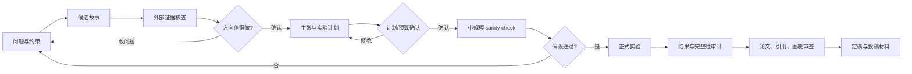

# Auto Research 全流程手册

这套流程把研究拆成可讨论、可复核的阶段。每一阶段留下一个能交给下一阶段使用的文件；研究者在科学问题、专家判断、费用和公开发布等关口作决定。工具建议和模型输出都是输入材料，不能代替证据。

## 一页流程



## 阶段 0：建立课题档案

```bash
python3 tools/create_research_project.py research-projects/<project-name>
```

填写 `RESEARCH_BRIEF.md`。把问题、已有数据/代码、目标人群、时间、算力、预算、许可限制、研究者允许的操作写进去。未知信息写“待核实”，不要用猜测填空。

产物：课题简报。进入下一阶段前，至少知道科学问题要解决什么、数据是否可取得、哪些决定需要专家或导师参与。

## 阶段 1：生成候选，不锁定结论

推荐从小范围开始：

```text
/idea-discovery <研究方向>
/research-lit <具体研究问题>
/novelty-check <候选贡献>
```

Idea2Paper 可以并行提出候选故事，建议从界面或 pipeline 运行。审查它引用了哪些论文、把什么当成已有事实、哪些内容只是推断。使用 `tools/package_idea2paper.py` 保存版本化快照：

```bash
python3 tools/package_idea2paper.py research-projects/<project-name> \
  --idea "本轮输入问题" --run-id 20261112-round01
```

每轮输出保存在 `idea2paper_runs/<run-id>/`；不要让后续运行覆盖前一轮。快照用于比较候选和交接，不表示新颖性已验证。

**方向关口：** 研究者选择保留、重构或停止的方向。通过标准是问题可证伪、文献差异具体、数据有机会回答，主要风险已列出。

## 阶段 2：核文献、数据和测量定义

对候选故事逐项做核查：

- 新颖性：检索近期论文和相关方法，阅读原文，记录检索式、日期、数据库、纳入范围和反例。
- 数据：确认数据版本、变量、抽样/划分、缺失机制、标签时间、许可和可分享范围。
- 测量或标注：将候选映射、编码、代理回答、跳题和特殊缺失逐项与原问卷/代码本对照，并保存原文位置。
- 专家判断：把需要专业判断的最小问题、候选选项、原文证据和“不确定”选项整理成表，先独立填答，有分歧再裁决。

专家的工作限于专业判断；研究团队负责整理材料、建规则、写代码和运行分析。专家意见未回收时，将相关设计状态标记为待确认，不能写成已验证。

**研究故事关口：** 把候选内容改写成可检验的主张。若外部证据显示贡献不成立，返回阶段 0 或结束，不因已投入模型调用而继续。

## 阶段 3：冻结主张和实验计划

在 `CLAIMS_AND_EVIDENCE.md` 为每条主张分配 ID，并区分：文献事实、方法定义、实验结果、探索性解释。每项结果主张都应预先对应实验和指标。

在 `EXPERIMENT_PLAN.md` 明确：

- 数据版本与划分、样本排除、标签窗口、缺失/死亡/删失处理。
- 主要基线及其信息条件；哪些方法可用目标标签，哪些不得使用。
- 主要指标、不确定区间、重复划分/随机种子和统计比较。
- 消融、敏感性分析、失败判据、可行性检查和复现实验命令。
- 机器、估算运行时长、费用上限、数据传输/保存位置、停止条件。

**预算关口：** 研究者审查实验矩阵、目标机器、最大费用和停止条件。未确认前只做文件检查、代码准备和明确限制的小规模可逆 sanity check；不提交长时间 GPU/云作业。

## 阶段 4：代码、数据和小规模验证

先版本化代码和配置；检查数据泄漏、划分穿越、预处理统计量、标签可见性、样本 ID 重复和评估代码。然后运行最小样本或少量种子，验证端到端命令、日志、输出 schema、checkpoint、结果可恢复性和资源占用。

记录到实验 tracker：commit、依赖环境、硬件、种子、命令、输入文件 hash、开始/结束时间、退出码和输出目录。API Key、个人数据行和可识别信息不进入 tracker。

**Sanity check 关口：** 数据/标签定义、评估脚本和 baseline 结果合理后再扩展。若异常，修正后重跑小样本，不要在批量结果上“边跑边猜”。

## 阶段 5：正式实验与运行记录

按预先计划执行。每个实验 ID 对应唯一配置和原始输出。训练/推理任务失败需保留失败记录；重跑需有新 run ID。修改假设、阈值或主要指标时记录决策及时间，说明它发生在查看哪些结果之前或之后。

监控只检查进程、日志、显存、磁盘、阶段进度和异常；无需持续请求 LLM。长任务结束后确认进程退出、文件写全、返回码为 0、结果可读取，再释放按小时计费的实例。

## 阶段 6：结果分析与主张裁决

用 `/analyze-results` 汇总实验，用 `/result-to-claim` 判断每条主张是支持、部分支持、混合、反驳或未测试，再用 `/experiment-audit` 检查泄漏、错误对照、缺失运行和数字来源。

负结果按条件、指标和估计值报告。不要将“方向未获得支持”伪装成阳性结果，也不要把预测性能等同于机制验证。每张图表都由保存的原始结果脚本再生成。

## 阶段 7：写作、引用和发布前检查

证据稳定后再写：

```text
/paper-plan <CLAIMS_AND_EVIDENCE.md>
/paper-writing <论文大纲或叙事报告>
/anti-defensive-writing <稿件或章节>
/citation-audit <稿件>
/paper-claim-audit <稿件与结果目录>
/paper-compile <LaTeX 项目>
```

把核心发现放在段首和结果主线中。必要的适用范围、假设和方法限制准确放在 Methods/Discussion/Limitations，不重复撒在摘要和贡献段。图表放在首次解释对应证据附近，避免图跨页打断句子；提交前目视检查 PDF 每一页。

文献核查至少检查论文是否真实、作者/年份/DOI/期刊信息、正文主张是否被原文支持、引用顺序及所有交叉引用。数值逐项回连结果文件。最终导出稿、源文件、图表源数据、审计结果和运行清单。

## 推荐的默认 ARIS Skill 路由

| 工作 | 首选 | 何时升级 |
|---|---|---|
| 开题 | `/idea-discovery` | 方向已很具体时用 `/research-refine-pipeline` |
| 文献 | `/research-lit` + `/novelty-check` | 单篇深读用 `/deepxiv` 或 `/alphaxiv` |
| 实验 | `/experiment-plan` | 计划锁定后用 `/experiment-bridge`、`/run-experiment` |
| 结果 | `/analyze-results` + `/result-to-claim` | 论文主张形成后加 `/experiment-audit` / `/paper-claim-audit` |
| 审稿 | `/research-review` | 大修闭环、双模型意见互补时用 `/auto-review-loop` |
| 写作 | `/paper-plan` + `/paper-writing` | 需要时加 `/anti-defensive-writing`、`/paper-figure`、`/paper-compile` |

默认不运行完整 `/research-pipeline`、批量 reviewer、所有检索源或所有 Skills。它们覆盖范围更大，只有当任务目标和预算明确时再启用。

## 推荐目录结构

```text
research-projects/<project>/
├── RESEARCH_BRIEF.md
├── STAGE_STATUS.md
├── CLAIMS_AND_EVIDENCE.md
├── decisions/                 # 方向、映射、方案变更的决策记录
├── literature/                # 搜索日志和引用核验记录
├── idea2paper_runs/<run-id>/  # 不可变候选方案快照
├── experiments/               # 计划、tracker、代码、汇总结果
└── paper/                     # 大纲、稿件、图表、PDF、审计
```

原始/受限数据放在另有访问控制的位置，不提交到公开仓库。项目目录模板解释见 [PROJECT_TEMPLATE_CN.md](PROJECT_TEMPLATE_CN.md)。
